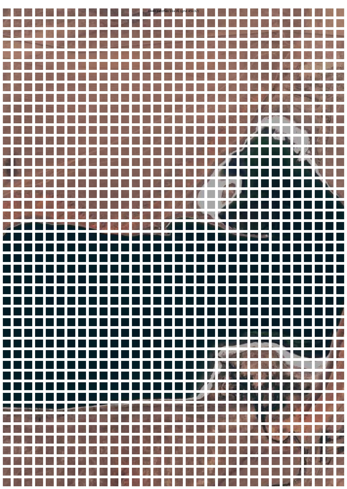
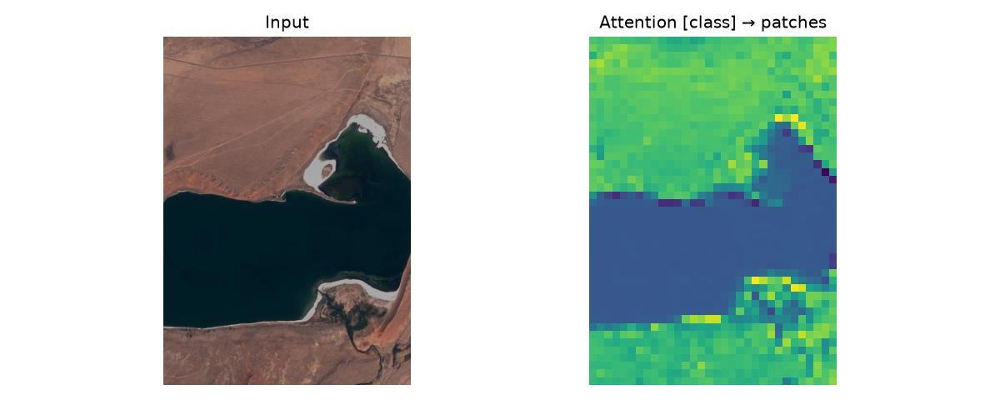
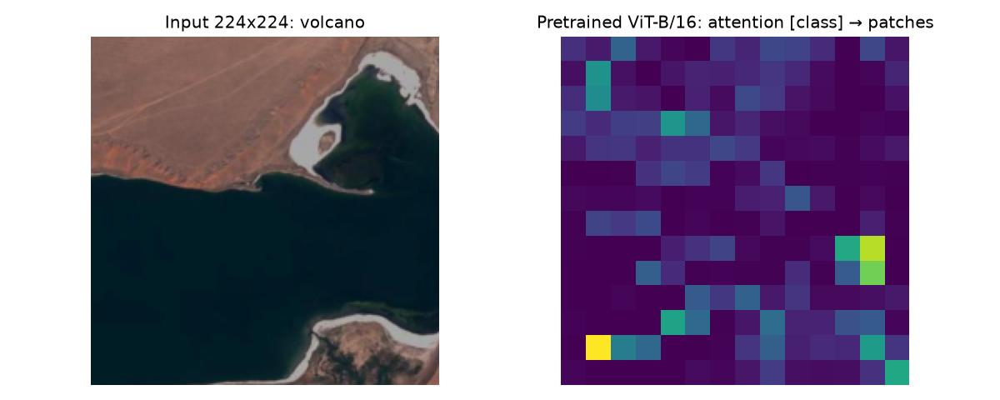

# Vision Transformer (ViT)

**Материал:** Dosovitskiy et al., *An Image is Worth 16×16 Words: Transformers for Image Recognition at Scale*.

Главная идея статьи: **сам трансформер-энкодер не менялся** — он взят практически без изменений из NLP (как в BERT). Изменился только способ *превратить изображение во вход*. Трансформер принимает 1D-последовательность эмбеддингов `(N, D)`, и вся адаптация под зрение сводится к тому, чтобы корректно построить такую последовательность из 2D-картинки.

---

# 1. Конспект статьи

## 1.1. Patch embedding (эмбеддинг патчей)

### Проблема
Трансформер работает с последовательностью токенов. Пиксель как токен не подходит: self-attention имеет квадратичную сложность по числу токенов, и для изображения 224×224 это ≈50 000 пикселей → миллиарды пар.

### Решение
Изображение режется на непересекающиеся квадратные **патчи** `P×P` (обычно 16×16). Каждый патч сплющивается в вектор и линейно проецируется в размерность модели `D`. Патч играет роль «слова».

### Формулы
- Размер исходного изображения: `x ∈ ℝ^(H×W×C)`
- Число патчей = длина последовательности:
  **N = H·W / P²**  (224×224, P=16 → N = 196)
- Длина одного сплющенного патча: **P²·C**  (16·16·3 = 768)
- Линейная проекция: матрица **E ∈ ℝ^(P²·C × D)**

### Практический трюк
Нарезку + проекцию удобнее всего сделать одним свёрточным слоём с `kernel_size = stride = P` — это математически эквивалентно «сплющить патч и умножить на E», но быстрее:

```python
patch_embed = nn.Conv2d(C, D, kernel_size=P, stride=P)
# (B, C, H, W) -> (B, D, H/P, W/P) -> flatten(2) -> transpose -> (B, N, D)
```

На выходе: тензор `(B, N, D)` — последовательность эмбеддингов патчей.

## 1.2. Позиционная информация (positional embedding)

### Зачем нужна
Self-attention **перестановочно-инвариантен** — он не знает, в каком порядке идут токены. Без позиционной информации «мешок патчей» (bag of patches) теряет, где что находилось. Поэтому к эмбеддингам патчей добавляется информация о позиции.

### Решение
Обучаемая матрица **E_pos ∈ ℝ^((N+1) × D)** (N+1 — потому что учитывается и class-токен, см. §1.3), которая просто **прибавляется** к эмбеддингам:

```python
self.pos_embed = nn.Parameter(torch.zeros(1, N + 1, D))
z = z + self.pos_embed
```

Авторы пробовали «умные» 2D-позиционные эмбеддинги (отдельно кодировать строку и столбец) и относительные — **прироста почти нет**. Обычные обучаемые 1D работают не хуже, потому что сеть сама выучивает 2D-топологию изображения (близкие патчи получают похожие позиционные эмбеддинги). Для кода это означает: берём простой 1D `nn.Parameter` и не усложняем.

### Деталь про дообучение в другом разрешении
Если дообучать на изображениях бо́льшего разрешения, размер патча оставляют прежним → число патчей растёт → предобученные позиционные эмбеддинги надо **интерполировать** (2D-интерполяция по сетке их исходных позиций). Это единственное место, кроме нарезки на патчи, где в модель вручную вносится знание о 2D-структуре.

## 1.3. Class token ([class]-токен)

### Идея (заимствована из BERT)
В начало последовательности добавляется один обучаемый вектор `x_class` размерности D. Он не относится ни к какому патчу — это «агрегатор». После прохода через энкодер его итоговое состояние используется как представление всего изображения, к которому цепляется классификатор.

Длина последовательности становится **N + 1**.

```python
self.cls_token = nn.Parameter(torch.zeros(1, 1, D))
cls = self.cls_token.expand(B, -1, -1)      # (B, 1, D)
z = torch.cat([cls, patches], dim=1)        # (B, N+1, D)
```

### Сборка входа энкодера — формула (1) из статьи

```
z₀ = [x_class; x¹E; x²E; …; x^N E] + E_pos
```

То есть: `[класс-токен + патчи]`, затем прибавить позиционные эмбеддинги.

### Альтернатива
Вместо class-токена можно усреднить эмбеддинги всех патчей (global average pooling). В статье показано, что оба подхода работают одинаково хорошо, но требуют разной скорости обучения. В основной статье используется именно class-токен — чтобы быть максимально близко к оригинальному трансформеру.

После энкодера берём только нулевой элемент (class-токен) и подаём в голову:

```python
y = self.norm(z)[:, 0]         # (B, D)
logits = self.head(y)          # (B, num_classes)
```

## 1.4. Особенности обучения

### Главный концептуальный момент: мало индуктивных смещений
У CNN в каждый слой встроены локальность и трансляционная эквивариантность. У ViT их почти нет — единственное место, где вносится 2D-структура, это нарезка на патчи; self-attention глобален уже с первого слоя. Отсюда следствие:

- На среднем датасете (ImageNet с нуля) ViT проигрывает ResNet на пару процентов — не хватает «встроенных подсказок», модель сильнее переобучается.
- При предобучении на больших данных (ImageNet-21k — 14 млн, JFT-300M — 300 млн) ViT догоняет и обгоняет CNN.

**Ключевой вывод:** «масштаб данных побеждает индуктивное смещение». На практике ViT почти всегда берут **предобученным**, а не учат с нуля.

### Схема предобучение → дообучение
- **Предобучение** на большом наборе; классификационная голова — MLP с одним скрытым слоем.
- **Дообучение** (fine-tuning) на целевой задаче: предобученную голову **убирают** и ставят новый линейный слой `D × K`, инициализированный нулями (K — число классов целевой задачи). На дообучении голова — один линейный слой.
- Часто дообучают в **более высоком разрешении**, чем предобучали (это повышает качество; требует интерполяции позиционных эмбеддингов — см. §1.2).

### Конкретные гиперпараметры из статьи
- Оптимизатор предобучения: **Adam** (β₁=0.9, β₂=0.999), батч **4096**, высокий weight decay **0.1**.
- Оптимизатор дообучения: **SGD** с моментом 0.9, батч 512.
- При обучении на небольших данных критична **регуляризация**: weight decay, dropout, label smoothing.
- Разрешение предобучения — 224, дообучения — обычно 384.
- Для ImageNet помогает **gradient clipping** по глобальной норме 1.

### Что внутри блока энкодера (стандартная часть)
L одинаковых блоков, **pre-norm** (LayerNorm *до* подблока), остаточные связи после. Формулы (2)–(4):

```
z'ℓ = MSA(LN(z_{ℓ-1})) + z_{ℓ-1}      # внимание
zℓ  = MLP(LN(z'ℓ)) + z'ℓ              # MLP (два слоя, нелинейность GELU)
y   = LN(z_L⁰)                        # берём class-токен последнего слоя
```

Self-attention:
```
[Q, K, V] = z · U_qkv
A = softmax(Q·Kᵀ / √d_h)
SA(z) = A · V
```

Multi-head — k параллельных голов в размерности `d_h = D/k`, конкатенация + проекция:
```
MSA(z) = [SA₁; SA₂; …; SA_k] · U_msa
```

---

# 2. Разбиение изображения на патчи и преобразование в embeddings

Код: [`vit_patch_embedding.py`](../vit_patch_embedding.py).

### Задача
Превратить 2D-изображение в последовательность векторов `(N, D)`, которую можно подать в трансформер-энкодер: разрезать картинку на непересекающиеся патчи `P×P` и линейно спроецировать каждый патч в пространство размерности `D`.

### Параметры
- Размер патча **P = 16**
- Размерность эмбеддинга **D = 768** (как в ViT-B)
- Каналы **C = 3** (RGB)

### Шаг 1. Загрузка изображения без ресайза
Вход — спутниковый снимок 516×732


В статье изображение приводится к 224×224, но сам patch embedding от размера не зависит, поэтому картинка подаётся в **исходном разрешении**: `ToTensor()` → `(1, C, H, W)`, значения в `[0, 1]`.

Единственное требование — **H и W должны делиться на P**. Иначе `Conv2d` со `stride = P` молча отбросит пиксели на краях, поэтому изображение обрезается снизу и справа до ближайшего кратного 16:

```
H' = ⌊H / P⌋ · P,   W' = ⌊W / P⌋ · P
```

Для снимка 732×516 (В×Ш): высота обрезается до 720 (теряется 12 строк), ширина — до 512 (теряется 4 столбца). (Альтернатива — дополнить изображение нулями до кратного 16 через `F.pad`: края не теряются, но последний ряд патчей частично заполнен нулями.)

### Шаг 2. Нарезка на патчи
Сетка патчей и их число считаются по реальному размеру:

```
Gh = H' / P,   Gw = W' / P,   N = Gh · Gw
```

Для 720×512: сетка **45 × 32**, **N = 1440** патчей (против 196 для 224×224).

Нарезка выполняется через `unfold` по высоте и ширине:

```python
patches = x.unfold(2, P, P).unfold(3, P, P)     # (B, C, Gh, Gw, P, P)
patches = patches.permute(0, 2, 3, 1, 4, 5)     # (B, Gh, Gw, C, P, P)
patches = patches.reshape(B, N, C, P, P)        # (B, N, C, P, P)
```

Патчи упорядочены построчно (слева направо, сверху вниз) — этот порядок задаёт индекс позиции, к которому потом привязывается positional embedding. Тензор `patches` используется для визуализации (рис. 2).

### Шаг 3. Линейная проекция в embeddings
Каждый патч — вектор длины `P²·C = 16·16·3 = 768`, который умножается на обучаемую матрицу `E ∈ ℝ^(P²·C × D)`. Нарезка и проекция делаются одной свёрткой `nn.Conv2d(C, D, kernel_size=P, stride=P)` (см. §1.1), затем `flatten(2)` и `transpose(1, 2)` дают `(B, N, D)`.

Эквивалентность свёртки и «сплющить патч + умножить на E» проверяется в коде численно: патчи из шага 2, сплющенные в `(B, N, P²·C)`, умножаются на `E = conv.weight.reshape(D, -1).T` и складываются с bias — результат совпадает с выходом `Conv2d`.

### Результат

```
Input:                (1, 3, 732, 516)
After crop:           (1, 3, 720, 512)
Patches:              (1, 1440, 3, 16, 16)
Patch embeddings:     (1, 1440, 768)
Conv2d == flatten @ E: True
```

| Этап | Форма тензора |
|---|---|
| Исходный вход | `(1, 3, 732, 516)` |
| После обрезки до кратного 16 | `(1, 3, 720, 512)` |
| Патчи | `(1, 1440, 3, 16, 16)` |
| Эмбеддинги патчей | `(1, 1440, 768)` |

### Ограничения при отказе от ресайза
- **Positional embedding** имеет фиксированный размер `(1, N+1, D)`. При обучении с нуля достаточно зафиксировать одно разрешение; при использовании весов, предобученных на 224 (N = 196), позиционные эмбеддинги нужно интерполировать под новую сетку (см. §1.2).
- Все изображения **в одном батче** должны быть одного размера.
- Сложность self-attention растёт как **N²**: 1441 токен против 197 — внимание примерно в 54 раза дороже: (1441/197)² ≈ 53,5.




---

# 3. Учебный ViT

Код: [`vit_model.py`](../vit_model.py).

### Связь с блоком подзадачи 5
Модель собрана из encoder-блока первого задания ([отчёт transformer_encoder](transformer_encoder.md), `transformer_encoder.py`): `MultiHeadAttention` (и внутри неё `scaled_dot_product_attention`) импортируется оттуда без изменений. Сам `EncoderBlock` приведён к варианту из статьи ViT — два отличия от оригинального трансформера:

| | Transformer (отчёт 1) | ViT (здесь) |
|---|---|---|
| Положение LayerNorm | после остаточной связи (post-LN): `LN(x + Sublayer(x))` | до подслоя (pre-LN): `x + Sublayer(LN(x))` |
| Нелинейность MLP | ReLU | GELU |

Pre-LN оставляет «чистый» остаточный путь от входа к выходу, поэтому глубокий стек стабильнее обучается; из-за этого после последнего блока нужен отдельный финальный `LayerNorm` (`y = LN(z_L⁰)`).

### Архитектура

```python
ViT(img_h, img_w, patch_size=16, in_channels=3, d_model=192,
    depth=6, num_heads=3, d_ff=768, num_classes=10)
```

| Модуль | Что делает | Обозначение в статье |
|---|---|---|
| `patch_embed` — `Conv2d(3, 192, 16, stride=16)` | нарезка + линейная проекция патчей | `E` |
| `cls_token` — `(1, 1, 192)` | обучаемый [class]-токен | `x_class` |
| `pos_embed` — `(1, N+1, 192)` | обучаемые позиционные эмбеддинги | `E_pos` |
| `blocks` — 6 × `EncoderBlock` | pre-LN энкодер, 3 головы по 64 | формулы (2)–(3) |
| `norm` — `LayerNorm(192)` | финальная нормировка | `LN` в формуле (4) |
| `head` — `Linear(192, 10)` | классификатор | — |

Ширина (`D = 192`, 3 головы, `d_ff = 768`) соответствует ViT-Tiny, глубина уменьшена с 12 до 6 блоков. Размер `pos_embed` вычисляется из размера изображения, поэтому модель принимает снимок в исходном разрешении (после обрезки до кратного 16).

### Проход изображения через модель
В `main()` прямой проход выполняется по шагам с печатью форм, затем результат сверяется с обычным вызовом `model(x)`:

```
Input:                (1, 3, 732, 516)
After crop:           (1, 3, 720, 512)
Patch embedding:      (1, 1440, 192)
+ class token:        (1, 1441, 192)
+ pos embedding:      (1, 1441, 192)
EncoderBlock 1:       (1, 1441, 192)
...
EncoderBlock 6:       (1, 1441, 192)
Attention weights:    (1, 3, 1441, 1441)
y = LN(z_L⁰):         (1, 192)
Logits:               (1, 10)
Matches model(x):     True
Predicted class:      5 (random weights)
```

- После добавления class-токена длина последовательности `N + 1 = 1441` и дальше не меняется: каждый блок отображает `(B, N+1, D) → (B, N+1, D)`.
- Веса внимания каждого блока — `(B, heads, N+1, N+1)`, это та самая квадратичная по числу токенов матрица.
- В классификатор идёт только нулевой токен — `(1, 192)`.
- `Matches model(x): True` — ручной пошаговый проход совпадает с `forward`.

### Карта внимания
По весам последнего блока берётся строка class-токена (`weights[0, :, 0, 1:]`), усредняется по головам и раскладывается обратно на сетку 45×32 (рис. 3).

Модель **не обучена** (веса случайные, предсказанный класс ничего не значит), поэтому карта не отражает «смысл». Она показывает другое: при случайных проекциях скалярные произведения зависят только от цвета и текстуры патчей. Поэтому вся тёмная вода получает одинаковый низкий вес и сливается в одно пятно, суша — вес выше, а самые яркие патчи лежат на границе воды и берега, у белой солевой каймы, где контраст максимален. Это сегментация «по цвету», а не понимание сцены. Обученную карту внимания см. в §4.



---

# 4. Предобученный ViT-B/16

Код: [`vit_pretrained.py`](../vit_pretrained.py). Используется `torchvision.models.vit_b_16` с весами `ViT_B_16_Weights.IMAGENET1K_V1` (классификация ImageNet, 1000 классов).

### Предобработка
`weights.transforms()`: resize до 256 → центральный кроп 224×224 → нормировка средним/стд ImageNet. Ресайз здесь обязателен: `pos_embedding` предобученной модели имеет фиксированный размер на 14×14 + 1 = 197 токенов. Наш снимок 516×732 (Ш×В) сначала уменьшается до 256×363 (короткая сторона = 256), затем из центра вырезается квадрат 224×224 — верхняя и нижняя части снимка в модель не попадают (см. рис. 4). Для сравнения: учебный ViT видит снимок целиком (1441 токен), предобученный — уменьшенный центр (197 токенов).

### Устройство модулей

| Модуль torchvision | Форма / структура | Параметров | Аналог в учебном ViT | В статье |
|---|---|---:|---|---|
| `conv_proj` | `Conv2d(3, 768, 16, stride=16)` | 590 592 | `patch_embed` | `E` |
| `class_token` | `(1, 1, 768)` | 768 | `cls_token` | `x_class` |
| `encoder.pos_embedding` | `(1, 197, 768)` | 151 296 | `pos_embed` | `E_pos` |
| `encoder.layers` | 12 × `EncoderBlock` | 12 × 7 087 872 | `blocks` | формулы (2)–(3) |
| `encoder.ln` | `LayerNorm(768)` | 1 536 | `norm` | `LN` в (4) |
| `heads.head` | `Linear(768, 1000)` | 769 000 | `head` | голова классификатора |
| **Итого** | | **86 567 656** | | |

Устройство одного `EncoderBlock` (pre-LN, как в учебной модели):

```
EncoderBlock(
  (ln_1): LayerNorm(768)
  (self_attention): MultiheadAttention(            # 12 голов по 64
    (out_proj): Linear(768, 768))
  (dropout): Dropout(p=0.0)
  (ln_2): LayerNorm(768)
  (mlp): MLPBlock(
    Linear(768, 3072) → GELU → Dropout → Linear(3072, 768) → Dropout)
)
```

Разбивка параметров блока:

| Часть | Параметров |
|---|---:|
| `self_attention.in_proj` — Q, K, V одной матрицей `768 × 2304` + bias | 1 771 776 |
| `self_attention.out_proj` — `768 × 768` + bias | 590 592 |
| `mlp` — `768 → 3072 → 768` | 4 722 432 |
| `ln_1`, `ln_2` | 3 072 |
| **Итого на блок** | **7 087 872** |

Отличия от учебной реализации:
- Q, K, V считаются одной матрицей `in_proj` (`U_qkv` из статьи), а не тремя `W_q, W_k, W_v` — математически то же самое, но одно матричное умножение вместо трёх.
- Внимание — стандартный `nn.MultiheadAttention`, а не самописная функция.
- Масштаб больше: `D = 768`, 12 голов, 12 блоков, `d_ff = 3072` (ViT-Base). Две трети параметров блока — в MLP.

### Проход изображения
Как и для учебной модели, проход выполняется по модулям вручную и сверяется с `model(x)`:

```
Input after transforms:  (1, 3, 224, 224)
Patch embedding:         (1, 196, 768)
+ class token:           (1, 197, 768)
+ pos embedding:         (1, 197, 768)
After 12 blocks:         (1, 197, 768)
Attention weights (last): (1, 197, 197)
Logits:                  (1, 1000)
Matches model(x):        True
```

### Предсказание

```
Top-5 ImageNet predictions:
  volcano                   0.660
  tile roof                 0.062
  valley                    0.027
  alp                       0.015
  cliff                     0.012
```

Модель уверенно (66%) выбирает `volcano`, но это ошибка: на снимке озеро в пустынной местности. Причина та же, что у любого классификатора ImageNet на чужих данных: в ImageNet нет спутниковых снимков и классов вроде «озеро» или «вид сверху», поэтому модель подбирает ближайший знакомый образ. Тёмное пятно воды посреди красно-бурой безжизненной поверхности похоже на кратер или застывшую лаву на фотографиях вулканов, а рыжая шероховатая текстура суши — на черепицу (`tile roof`). Остальные варианты (`valley`, `alp`, `cliff`) — тоже пейзажные классы, то есть общий тип сцены «природный ландшафт» модель уловила верно. Высокая уверенность при неверном ответе показывает, что вероятности softmax нельзя считать оценкой надёжности на данных вне распределения. Это иллюстрирует §1.4: чтобы применить ViT к спутниковым снимкам, предобученную голову заменяют новой линейной и дообучают модель на целевых данных.

### Карта внимания
Карта строится так же, как в §3: внимание class-токена последнего блока (усреднено по 12 головам) на сетке 14×14 (рис. 4). В отличие от случайной модели, внимание обученной сконцентрировано на нескольких отдельных патчах в однородных областях — в толще тёмной воды и на ровной суше, — а не на береговой линии, которая определяет сцену. Такие «выбросы» в поздних слоях больших ViT известны: модель использует малоинформативные фоновые патчи как служебное хранилище глобальной информации (Darcet et al., *Vision Transformers Need Registers*, 2023). Поэтому сырое внимание последнего слоя — плохое объяснение предсказания.



---

# 5. Число токенов для разных разрешений и размеров патча

Код: [`vit_token_count.py`](../vit_token_count.py).

Число патчей для квадратного изображения `R×R` и патча `P×P`:

```
N = (R / P)²,   длина последовательности = N + 1 (с class-токеном)
```

Для прямоугольного — `N = ⌊H/P⌋ · ⌊W/P⌋` (наш снимок 720×512 при P = 16 → 45·32 = 1440).

Память под матрицу внимания одного слоя: `heads · (N+1)² · 4 байта` (12 голов как в ViT-B, float32, B = 1). Последний столбец — во сколько раз дороже внимание по сравнению с базовой конфигурацией 224/16.

| Разрешение | Патч | Сетка | N | N+1 | Внимание, МБ | vs 224/16 |
|---:|---:|---:|---:|---:|---:|---:|
| 224 | 8 | 28×28 | 784 | 785 | 29.6 | 15.9× |
| 224 | 14 | 16×16 | 256 | 257 | 3.2 | 1.7× |
| 224 | **16** | **14×14** | **196** | **197** | **1.9** | **1.0×** |
| 224 | 32 | 7×7 | 49 | 50 | 0.1 | 0.1× |
| 384 | 8 | 48×48 | 2304 | 2305 | 255.0 | 136.9× |
| 384 | 14 | 27×27 | 729 | 730 | 25.6 | 13.7× |
| 384 | 16 | 24×24 | 576 | 577 | 16.0 | 8.6× |
| 384 | 32 | 12×12 | 144 | 145 | 1.0 | 0.5× |
| 512 | 8 | 64×64 | 4096 | 4097 | 805.7 | 432.5× |
| 512 | 14 | 36×36 | 1296 | 1297 | 80.7 | 43.3× |
| 512 | 16 | 32×32 | 1024 | 1025 | 50.4 | 27.1× |
| 512 | 32 | 16×16 | 256 | 257 | 3.2 | 1.7× |
| 1024 | 8 | 128×128 | 16384 | 16385 | 12886.5 | 6917.7× |
| 1024 | 14 | 73×73 | 5329 | 5330 | 1363.6 | 732.0× |
| 1024 | 16 | 64×64 | 4096 | 4097 | 805.7 | 432.5× |
| 1024 | 32 | 32×32 | 1024 | 1025 | 50.4 | 27.1× |

Выводы:
- `N` растёт **квадратично по разрешению** и **обратно квадратично по размеру патча**: удвоение разрешения или уменьшение патча вдвое даёт в 4 раза больше токенов, а внимание — в ~16 раз дороже (`N²`).
- Обозначение модели `/16`, `/32` в статье — это размер патча. ViT-B/32 при 224 работает всего с 50 токенами, ViT-B/16 — с 197: меньше патч → выше детализация, но дороже.
- Если разрешение не делится на патч (224/14 → 16, 384/14 → 27, 1024/14 → 73), край изображения отбрасывается.
- Дообучение на 384 вместо 224 (§1.4) при P = 16 даёт 577 токенов вместо 197 — внимание дороже в ~8.6 раза, и позиционные эмбеддинги приходится интерполировать с сетки 14×14 на 24×24.
- Мелкий патч на большом разрешении (1024/8) требует ~13 ГБ только на матрицы внимания одного слоя — поэтому для плотных задач и больших изображений используют иерархические ViT с локальным окном внимания (например, Swin).

---

## Как запустить

Из корня проекта:

```bash
python vit_patch_embedding.py   # §2: патчи и эмбеддинги → result_ViT/patches_grid.jpg
python vit_model.py             # §3: учебный ViT → result_ViT/attention_map.jpg
python vit_pretrained.py        # §4: ViT-B/16 → result_ViT/pretrained_attention_map.jpg
python vit_token_count.py       # §5: таблица числа токенов
```

При первом запуске `vit_pretrained.py` torchvision скачивает веса ViT-B/16 (~330 МБ).
